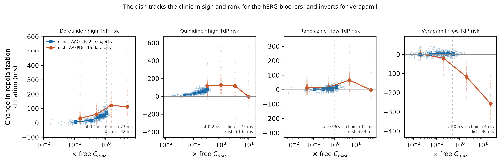

# dish2ecg

**Repository:** https://github.com/rejaul/dish2ecg

**Corrected repolarization endpoints from hiPSC-CM recordings and from clinical
ECG, computed by one cascade and compared on one scale.**

A field potential duration measured from a cardiomyocyte monolayer is not a QT
interval, and this package will not pretend otherwise — asking an in-vitro
endpoint for milliseconds of QT raises an error. What it does is apply the *same*
correction algebra to both domains, so that a concentration–response measured in
a dish and a clinical concentration–QTc relationship become comparable objects.

    raw interval            QT / RR          FPD / interbeat interval
      ↓ rate correction     QTcF, QTcI       FPDcF
      ↓ baseline            ΔQTcF            ΔFPDc
      ↓ placebo / vehicle   ΔΔQTcF           ΔΔFPDc
      ↓ mixed model         C-QTc slope      concentration–response slope
      ↓ shared scale              multiples of free Cmax

## Why this exists

Three software layers already exist in cardiac safety: signal processing that
turns a raw trace into a field potential duration (open tools such as Cardio PyMEA
and CardioMEA, and vendor software), risk classifiers that turn in-vitro features
into a torsade category, and clinical concentration-QTc analysis, which mostly lives
in sponsor and regulator statistical environments; the open implementations found
are an R package that drives the commercial MonolixSuite and an R power-calculation
repository, not an analysis that stands alone. To our knowledge, none couples the
clinical analysis to an in-vitro cascade (a November 2026 screen of PubMed, OpenAlex
and the web; absence of a hit is not proof of absence). The correction and
translation layer between them — the part that decides what a number *means* — is
the one this package supplies. See docs/PROJECT_REPORT.md for the narrative report of the whole project, and docs/RESEARCH_REPORT.md (frozen at 0.1.1) for the early technical reference.

## Install

```bash
pip install -e .            # core
pip install -e ".[data,plot,dev]"   # + PhysioNet fetching, figures, tests
```

## Quickstart

```python
import pandas as pd
from dish2ecg import fridericia, double_delta, fit_concentration_response
from dish2ecg.io import load_physionet_clinical

df = load_physionet_clinical("ecgrdvq")      # downloads + verifies sha256
qtcf = fridericia(df["QT"], df["RR"])        # -> Endpoint, carrying provenance
print(qtcf.describe())
```

Every derived value is an `Endpoint` that carries the ordered list of corrections
that produced it, with the formula and the citation for each. The modelling layer
checks that list before it will fit: a concentration-QTc model refuses an endpoint
that has not been baseline- and placebo-corrected, and names what is missing.

```python
from dish2ecg import power_correction
fpdc = power_correction(fpd_ms, interbeat_ms, 1/3, name="FPDcF", domain="invitro")
fpdc.as_qt_milliseconds()
# DomainError: 'FPDcF' is an in-vitro endpoint and cannot be expressed as a QT
# interval in milliseconds. Use percent change or a standardized effect and
# compare concentration-response slopes (dish2ecg.bridge.to_shared_scale).
```

## Reproducing the reference analysis

```bash
python scripts/clinical_reference.py --out results/
python scripts/build_wells.py --workbook Blinova_etal_2018_data.xlsx
python scripts/invitro_and_bridge.py --wells data/cipa_myocyte_wells.csv --out results/
python scripts/validate_invitro_correction.py --out results/
python scripts/ecgcipa_reference.py --out results/
```

No data ships with the repository; see [data/README.md](data/README.md) for what is
fetched and from where.

## What is validated, and what is not

**Validated against published values — ECGRDVQ, the four bridge drugs.**
Vicente J et al., *J Am Heart Assoc* 2015;4:e001615, doi:10.1161/JAHA.114.001615,
Table 2 reports the baseline- and placebo-corrected change at the population Cmax
for exactly the four drugs that form the dish-to-clinic bridge. **Agreement is
8 of 8**: every published point estimate falls inside our two-sided 90 %
interval, and each of the three biomarkers the paper reports as having no
concentration relationship corresponds to an interval of ours containing zero.

| arm | endpoint | published (95 % CI) | dish2ecg (90 % CI) |
|---|---|---|---|
| Dofetilide | ΔΔQTcF | 73.6 [65.8, 81.5] | 73.1 [68.5, 77.7] |
| Quinidine | ΔΔQTcF | 78.9 [68.2, 89.7] | 74.9 [69.3, 80.5] |
| Ranolazine | ΔΔQTcF | 12.0 [7.3, 16.7] | 11.2 [7.6, 14.8] |
| Verapamil | ΔΔQTcF | no relationship | 3.5 [-0.1, 7.0] |
| Dofetilide | ΔΔJ-Tpeakc | 39.1 [31.6, 46.6] | 38.7 [32.8, 44.6] |
| Quinidine | ΔΔJ-Tpeakc | 26.1 [13.5, 38.7] | 27.7 [22.3, 33.2] |
| Ranolazine | ΔΔJ-Tpeakc | no relationship | 2.8 [-0.2, 5.8] |
| Verapamil | ΔΔJ-Tpeakc | no relationship | 0.6 [-2.4, 3.5] |

Our geometric-mean Cmax matches their population mean within 15 % for all four
agents, and to one decimal place for dofetilide (2.7 ng/mL).

**Validated against published values — ECGCIPA, day-stratified.** Vicente J et
al., *Clin Pharmacol Ther* 2019;105:943-953, doi:10.1002/cpt.1303. The
specification matters: this is a multiple-dose design and the prespecified
endpoints are evaluated at Cmax **on a named day** — ΔΔJ-Tc on day 3 for the
balanced blockers, ΔΔQTc on day 1 for chloroquine. Pooling the days gives correct
point estimates with intervals that are too narrow. Respecting the stratification,
**6 of 8** published point estimates fall inside our 90 % interval and 6 of 8
reach the same verdict against 10 ms. Both misses are verapamil ΔΔQTcF and they
run in opposite directions (5.7 ms low on day 1, 3.3 ms high on day 3) — a linear
model on a curved concentration–response, which the paper itself reports testing
against Emax and sigmoid alternatives. The ranolazine disagreement is precision,
not effect: point estimates agree to 2 ms, but our upper bound is 9.3 ms against
their 12.0, which flips the regulatory call.

**Validated against published values — ECGDMMLD.** The clinical pipeline is run on ECGDMMLD
and compared with the placebo- and baseline-corrected changes at Tmax reported in
Vicente J et al., *PLoS ONE* 2016;11:e0163619, Table 3. The published point
estimate falls inside our 95 % confidence interval for **5 of 6** comparisons.

| arm | endpoint | dish2ecg | published |
|---|---|---|---|
| Dofetilide | ΔΔQTcF | 39.0 [32.7, 45.3] | 45.2 [37.8, 52.6] |
| Dofetilide | ΔΔJ-Tpeakc | 22.1 [15.2, 29.0] | 29.1 [20.2, 38.0] |
| Dofetilide | ΔΔTpeak-Tend | 16.6 [6.9, 26.2] | 17.9 [9.0, 26.7] |
| Mexiletine + Dofetilide | ΔΔQTcF | 19.2 [12.5, 25.8] | 17.3 [11.6, 23.0] |
| Mexiletine + Dofetilide | ΔΔJ-Tpeakc | 2.2 [-4.1, 8.6] | 1.1 [-5.5, 7.7] |
| Mexiletine + Dofetilide | ΔΔTpeak-Tend | 14.9 [10.5, 19.3] | 14.6 [10.0, 19.2] |

**The dofetilide gap is resolved, and it was not ours.** Those two rows compare
against Vicente 2016 Table 3. The *primary* paper for the same study and arm —
Johannesen L et al., *Clin Pharmacol Ther* 2015;99:214-223, doi:10.1002/cpt.205 —
reports dofetilide alone prolonging QTc by **39.1 ms** after the evening dose and
**22.4 ms** after the afternoon dose. Our pipeline gives **39.0 ms** and **22.2 ms**
at the same timepoints. The two published papers disagree with each other by 6 ms
on the same data; we match the primary one to 0.1-0.2 ms. The table below is kept
as published, with both targets named.

The qualitative result the source paper was built on *is* reproduced exactly.
Dofetilide, a selective hERG blocker, prolongs both QTcF and J-Tpeakc. Adding
mexiletine, a late sodium current blocker, leaves ΔΔQTcF at 20.8 ms
[16.6, 25.0] while collapsing ΔΔJ-Tpeakc to 2.6 ms [-1.5, 6.7]. Ranolazine and
verapamil, both multichannel blockers, likewise show prolonged QTcF with a
J-Tpeakc interval indistinguishable from zero.

**Validated against closed-form truth.** 142 tests. See `READING_LIST.md` for the
sources behind each validation and what is still unread. Rate corrections are checked
against their defining formulas; fitted exponents are recovered to 1e-6 from
simulated data with a known exponent; the double-delta cascade recovers a known
drug effect exactly in the presence of subject offsets and a circadian term; Emax
parameters are recovered from a noiseless curve. Confidence-interval coverage is
tested as a frequency property over 60 simulated studies rather than asserted on
one seed.

**The in-vitro rate correction, validated against an independent published
implementation.** The CiPA myocyte workbook publishes `ddFPDc` already corrected,
so it cannot test our correction. The CiPA **MEA pilot** can: Supplemental Table 1
of Millard D et al., *Toxicol Sci* 2018;164:550-562, doi:10.1093/toxsci/kfy110
reports mean baseline beat period, field potential duration **and** rate-corrected
field potential duration for each of the 18 participating studies — three
quantities with one formula between them. Recovering that table (it is published
as a vector image; `dish2ecg.io.emf_tables` reads the drawn text records out of
the metafile, so the digits come back verbatim rather than by OCR) and applying
our Fridericia correction to it:

- **17 of 18 studies agree within 5 ms**, median absolute difference 0.6 ms,
  worst relative error 1.28 %.
- The exponent implied by their published values is **0.3244** against
  Fridericia's 0.3333.
- The residual grows with the spread of the beat period
  (Spearman ρ = 0.592, p = 0.010), which is what Jensen's inequality predicts when
  a *mean of per-well corrected values* is compared against a *correction applied
  to the means* — the only comparison a summary table permits.
- **Study 9 (CDI / ACA) does not reproduce**: 22.0 ms off, and its beat-period
  coefficient of variation is only 0.061, so averaging order does not account for
  it. We have no explanation, and the test suite asserts the discrepancy rather
  than hiding it.

**The clinical corrections, validated per record against the study's own.**
PhysioNet ECGCIPA (Vicente J et al., *Clin Pharmacol Ther* 2019;105:943-953,
doi:10.1002/cpt.1303) ships the study's own derived QTcF and J-Tpeakc alongside
the raw intervals, for 5740 complete records. Against those:

- our Fridericia **QTcF matches exactly** — median difference 0.000 ms, SD 0.190
  ms, and only 3 of 5740 records differ by more than 0.05 ms;
- our baseline subtraction matches their change-from-baseline to a median of
  0.04 ms (SD 0.22) over 1915 records;
- their **J-Tpeakc is not the Hnatkova 2019 linear correction**. Regressing
  log(JTp/JTpc) on log(RR) recovers a pure power law with exponent **0.5799**,
  intercept 0.000, residual SD 0.15 ms. That is the FDA's J-Tpeakc = JTp/RR^0.58,
  the prespecified formula stated in Vicente 2019 itself (attributed there to
  Johannesen 2014, doi:10.1038/clpt.2013.238, not read here), so the 0.5799 is a
  confirmation, not a discovery. The package first declined to hard-code the exponent
  because the plain-text rendering of that paper drops superscripts; the PMC XML
  shows it. It is now `jtpeakc_power`, and it differs from the linear form by a median of
  0.44 ms, SD 3.56 ms, maximum 21.1 ms — material against a 10 ms threshold, so
  the two are kept separate and the choice has to be deliberate.

**Still not validated.** The baseline and vehicle subtraction steps of the
in-vitro path have no public dataset to check against — the only well-level
corpus arrives with them already applied — so they are exercised on synthetic
data with known ground truth and on the clinical corpus, where the same code path
is validated against published values. Hysteresis correction is implemented but
**cannot be identified** from these studies: the waveforms are 10-second strips,
which is 8-17% of one QT adaptation time constant, so the RR history that sets the
QT mostly precedes the recording. Measured consequence in METHODS 3.8.

## Visualising what is measured

```python
from dish2ecg.viz import read_wfdb, read_wfdb_annotations, plot_ecg_beat
rec = read_wfdb("medians/1001/00ed2097-cd14-4f03-ab33-853da5be5550")
ann = read_wfdb_annotations("...atr")      # -> [(sample, "("), (sample, "t"), ...]
plot_ecg_beat(rec, lead="II", fiducials=..., intervals=...)
```

`python scripts/make_figures.py --out results/ --wf <dir with a median beat>`
writes three figures. The first panel is a **real** median beat from PhysioNet
annotated with the study's own fiducial points; the beat is self-checking,
because the gaps between those fiducials reproduce the clinical table's measured
PR, QRS, J-Tpeak, Tpeak-Tend and QT exactly (133, 95, 205, 77, 377 ms for the
demo record). The field-potential panel is a **schematic** and says so: no public
dataset in this project ships hiPSC-CM waveforms.

`dish2ecg.viz` contains a minimal WFDB format-16 reader so the package gains no
dependency for reading a median beat; it raises `NotImplementedError` on any
other format rather than guessing.

## The bridge result

Four agents appear in both corpora. Comparing each at the geometric-mean observed
clinical free Cmax — not at 1× free Cmax, which would be extrapolation for two of
them:

| drug | TdP risk | at × free Cmax | clinic ΔΔQTcF | dish ΔΔFPDc | sign |
|---|---|---|---|---|---|
| Dofetilide | high | 1.07 | +73.1 [68.5, 77.7] | +132.0 [93.1, 170.8] | agree |
| Quinidine | high | 0.29 | +74.9 [69.3, 80.5] | +135.1 [82.2, 187.9] | agree |
| Ranolazine | low | 0.96 | +11.2 [7.6, 14.8] | +38.8 [22.8, 54.7] | agree |
| Verapamil | low | 0.50 | +3.5 [-0.1, 7.0] | −86.3 [-98.9, -73.6] | **invert** |

Three of four agree in sign and the dish preserves the rank of the prolongers,
while overstating their magnitude by roughly two- to threefold. Verapamil inverts:
calcium channel block shortens the field potential in a monolayer and does
essentially nothing to the clinical QT. Four drugs is not a validation of the
bridge — it is the entire overlap that public data allows, and it is reported as
such.



## The bridge is drug-level. It is not personalised, and there is evidence against that.

This is the sharpest boundary on the package and it comes from a direct
experiment, not an argument. Blinova K et al., *Clin Transl Sci* 2019;12:687-697,
doi:10.1111/cts.12674 reprogrammed iPSC-CMs **from the same subjects** who had
provided intensive concentration–QTc data in the ECGDMMLD study: 20 subjects
dosed with dofetilide or moxifloxacin alone, lines derived for 17, cardiomyocytes
for 16. Comparing each subject's own ΔΔAPD₉₀c concentration-response slope with
that same subject's clinical ΔΔQTc slope, by Spearman rank correlation:

| comparison | ρ | p |
|---|---|---|
| Moxifloxacin, ΔΔAPD₉₀c vs ΔΔQTc slope | −0.089 | 0.75 |
| Dofetilide, ΔΔAPD₉₀c vs ΔΔQTc slope | −0.106 | 0.70 |
| Baseline APD₉₀c vs baseline QTc | −0.025 | 0.93 |
| Clinical ΔΔQTc: dofetilide vs moxifloxacin, same subject | 0.096 | 0.73 |

None. Repeating it with Fridericia-corrected ΔΔAPD₉₀cF gave p = 0.47 and 0.97.

Two things follow. First, **do not use this package for individual risk
prediction** — the dish-to-clinic relationship it quantifies is a property of
drugs, not of people, and the one subject-matched test of the personalised claim
found nothing. Second, note the last row: a subject's clinical QT response to one
hERG blocker does not predict their response to another either. The subject-level
signal is weak on the *clinical* side too, so the dish is not solely at fault, and
a bigger or more mature dish model would not obviously fix it.

The same paper reports the positive side of the ledger: no arrhythmia-like events
in any of the 16 healthy lines, against a long-QT type 1 patient line that showed
them at 0.5, 4 and 8 nM dofetilide in 1 of 6, 5 of 11 and 11 of 12 wells. The
assay separates a diseased genotype from healthy ones; it does not rank healthy
individuals.

## References

Every paper this package relies on, with CrossRef-verified authors, journals and DOIs,
is listed in [REFERENCES.md](REFERENCES.md).
[docs/TRANSLATION_REVIEW.md](docs/TRANSLATION_REVIEW.md) reviews the literature on *why* the dish
and the clinic differ — 20 mechanisms, each with a direction of bias where one is known. `READING_LIST.md` tracks what has been read
and what is still closed-access.

## Limitations

- FPD is not QT, and no calibration in this package converts one to the other.
  The validation above tests the *rate correction*, not the translation.
- The in-vitro endpoint's missingness is informative: wells in arrhythmia have no
  measurable duration, and they are concentrated at the high concentrations where
  the effect is largest. Every in-vitro fit is reported alongside a
  low-concentration sensitivity fit for this reason.
- Two of the fifteen in-vitro datasets are voltage-sensing optical rather than
  MEA; in those the `ddFPDc` column is really ΔΔAPD₉₀c, a different quantity under
  the same name.
- The clinical anchor is **11 molecules in 104 healthy volunteers** across three
  studies, and only **4 of them are both given as a single agent and present in
  the in-vitro panel**
  (dofetilide, quinidine, ranolazine, verapamil). Lidocaine, mexiletine,
  moxifloxacin and diltiazem appear only in two-drug arms, so their own
  concentration–QTc effect is not separately identifiable. The third study
  (ECGCIPA) adds chloroquine, lopinavir and ritonavir — none of which is in the
  28-drug CiPA myocyte panel — so it widens the clinical corpus without widening
  the bridge. Four drugs is the whole intersection, and adding a third clinical
  study did not change that.
- **The anchor itself moves between studies by about as much as the regulatory
  threshold is wide.** Ranolazine, verapamil and dofetilide have an independent
  estimate from a second study (ECGCIPA). Evaluated at a *matched* plasma
  concentration it gives a ΔΔQTcF **5.0 to 9.7 ms higher** than the 22-subject
  crossover for all three, and for dofetilide (34.1 [29.8, 38.3] vs 43.7 [39.0, 48.5]
  ms) the 90 % intervals do not overlap. ECGCIPA is not uniformly parallel: ranolazine
  and verapamil are 10-per-arm parallel arms, dofetilide a 10-subject part 2
  crossover, and one part 1 placebo group is subtracted from every arm. Measured by
  refitting with no placebo subtraction, that shared group explains roughly 2–4 ms
  of the shift (all of it for verapamil); **6–7 ms remains for ranolazine and
  dofetilide and is unexplained**. An earlier claim that unpaired placebo subtraction
  in a parallel design was the likely cause is withdrawn. A bridge calibrated on one
  clinical study carries at least this much unmodelled between-study error.
- Those subjects are non-overlapping cohorts, aged 19–35, with no
  structural heart disease, no electrolyte disturbance and no concomitant
  QT-prolonging therapy. The endpoint is QTc prolongation, not torsade: there are
  zero arrhythmic events in the corpus, and none would be expected. The anchor
  therefore calibrates a surrogate, in the population least likely to express the
  outcome the assay exists to predict.
- Exposure is also short of therapeutic for part of the panel: the observed
  clinical free Cmax reaches only 0.29× the CiPA free Cmax for quinidine and 0.50×
  for verapamil.
- Individual rate correction leaves so little between-subject variance that the
  mixed model's random-intercept variance is estimated at zero; the package
  detects this, refits as OLS with cluster-robust standard errors, and flags it in
  `boundary_fallback`.

## Citation

See `CITATION.cff`. The underlying data must be cited independently — see
[data/README.md](data/README.md).

## Licence

MIT, Copyright (c) 2026 Rejaul Karim; see `LICENSE`. This covers the code and the derived concentration lookup
only; the upstream datasets carry their own terms.
